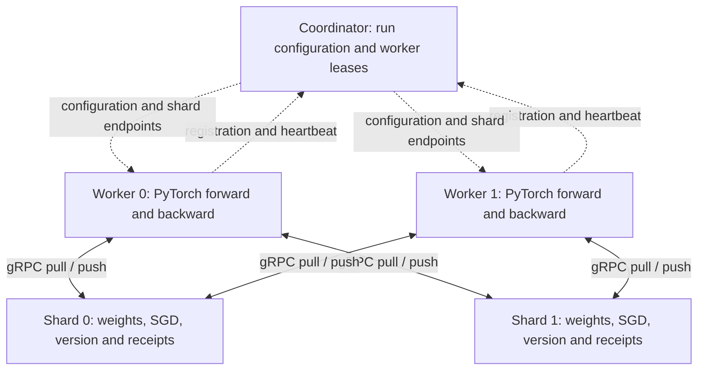

# ParamMesh

A distributed parameter-server training core with independently running PyTorch
workers, a membership coordinator and sharded authoritative model state. The
repository owns the gRPC protocol, gradient validation, SGD updates, versioning,
replay protection and synchronization behavior.

**Status: local recovery verified.** Independent CPU workers and parameter shards
survive tested process failures using durable local state. Synchronous recovery
is checked against equivalent uninterrupted PyTorch SGD. Checkpoint export to
object storage, operational dashboards and public deployment remain future work.

[Architecture](ARCHITECTURE.md) · [Evidence and methodology](BENCHMARKS.md) ·
[Security boundaries](SECURITY.md) · [Roadmap](ROADMAP.md)

## What this proves

- Control-plane membership is separate from worker-to-shard gradient traffic.
- Typed network boundaries reject malformed tensors and inconsistent updates.
- Concurrent workers synchronize through explicit shard-local gradient barriers.
- Ambiguous RPC delivery and process restart preserve durable update receipts.
- Write-ahead worker journals finish partially delivered steps without recomputing
  their original synchronous gradients from a partly updated model.
- Synchronous numerical correctness is compared with a real autograd baseline.

## Why this project exists

Parameter servers make optimizer ownership, stale gradients, membership and
failure boundaries explicit. A small CPU model keeps the focus on those systems
decisions. No Ray Train, DDP, Horovod or other distributed trainer implements the
protocol underneath this project.

## Run the distributed demo

Requires Python 3.12 on an x86-64 machine. Native Windows, local Linux containers
and Linux GitHub Actions checks have been exercised.

```powershell
python -m venv .venv
.\.venv\Scripts\Activate.ps1
python -m pip install --upgrade pip
python -m pip install torch==2.15.0 --index-url https://download.pytorch.org/whl/cpu
python -m pip install -e ".[dev,train]"
paramesh demo --mode sync --workers 2 --shards 2 --steps 20 --output artifacts/sync.json
```

On Linux, activate with `source .venv/bin/activate`. The demo starts **five child
processes**: one coordinator, two parameter shards and two workers. Actual gRPC
calls carry model parameters and gradients. Parent-owned local IPC carries startup
configuration, ephemeral credentials, stop signals and demo results. Temporary
state and child processes are cleaned up when the command finishes.

The workload is a seeded 4 → 8 → 1 MLP with tanh, 32 synthetic regression examples
per worker and shard-owned SGD. The JSON output records loss, shard versions,
parameter ownership, worker completion, source provenance and the synchronous
reference error. This command is a correctness demonstration, not a scaling benchmark.

[Original core evidence](docs/evidence/README.md) records the baseline numerical
run. Its 20-step sync run reduced full-dataset MSE from 14.232687
to 0.733824 with maximum absolute parameter error `5.96e-8` versus local SGD.

```powershell
paramesh demo --mode async --output artifacts/async.json
paramesh demo --mode bounded --output artifacts/bounded.json
```

## Core capabilities

| Area | Working behavior |
| --- | --- |
| Transport | Generated `paramesh.v1` gRPC contracts, deadlines, 8 MiB RPC limit |
| Membership | Configured worker IDs, session leases, suspect/unavailable thresholds, completion |
| Recovery | Durable coordinator metadata, shard commits, worker journals and generation fences |
| Ownership | Stable SHA-256 parameter-name hashing for an immutable shard count |
| Validation | Run, worker, sequence, version, identity, shape, dtype, byte length and finite values |
| SGD | Shard-local authoritative weights; mean or sum aggregation in synchronous mode |
| Synchronous | Fixed membership, one contribution per worker, barrier timeout without a local commit |
| Asynchronous | Atomic local updates with reported shard-local staleness |
| Bounded | Reject excessive shard-local lag; refresh and recompute uncommitted contributions |
| Delivery | Durable latest-step receipts prevent duplicate application after a shard restart |
| Admission | Bounded concurrent RPCs and bounded tensor collections |
| Security | Separate data/admin credentials, private networking and optional TLS/mTLS |

## Architecture and training flow



Workers register, pull parameters, compute a real forward/backward pass, partition
gradients by parameter name, submit each shard's contribution and repeat. Workers
do not own an optimizer. See [ARCHITECTURE.md](ARCHITECTURE.md) for exact semantics.

## Synchronization and failure boundaries

Synchronous mode requires every configured worker at each shard. A missing worker
aborts that shard's pending barrier rather than silently shrinking participation.
Async mode permits older gradients; bounded mode enforces `max_staleness` against
each shard's current version. Mean aggregation assumes equal worker batch sizes.

**There is no cross-shard transaction.** A failure can leave an update committed
on one shard and pending on another. Async and bounded pulls can observe different
shard versions; bounded mode does not provide a globally consistent model snapshot
or classic SSP worker-clock guarantees. Durable journals preserve unfinished
requests after a process crash; rollback after losing local state is a separate,
currently unsupported recovery boundary.

## Reproduce process recovery

```powershell
paramesh demo --failure worker --steps 20 --output artifacts/worker-recovery.json
paramesh demo --failure shard --steps 20 --output artifacts/shard-recovery.json
```

These commands terminate a real process during synchronous training, retain its
state, restart it and require final parameters to match local SGD within `1e-6`.
Worker recovery includes observed heartbeat expiry and a new fencing generation.
Reports record detection and progress-recovery durations, with intentional step
pacing for a visible failure window. Uncommitted computation loss is labeled
unmeasured rather than inferred from a status value.

## Start components independently

Run each command in a separate terminal, with the environment activated. Set
`PARAMESH_RPC_TOKEN` to the same strong URL-safe credential in every component,
and a distinct `PARAMESH_ADMIN_TOKEN` in coordinator/shard terminals only. The
container setup below generates these without printing them. Native component
commands fail closed when credentials are absent.

```powershell
paramesh coordinator --config examples/local.json
paramesh shard --config examples/local.json --index 0
paramesh shard --config examples/local.json --index 1
paramesh worker --coordinator 127.0.0.1:50050 --id worker-0 --steps 20
paramesh worker --coordinator 127.0.0.1:50050 --id worker-1 --steps 20
```

Inspect membership with `paramesh status`. Default state lives under `state/`;
restart against the same state to resume. An already completed worker exits
without repeating training. Use a fresh `--state-dir` for a different run or model;
existing state is never silently reset to fit new configuration.

## Containers

```powershell
python scripts/create_dev_env.py
docker compose up --build -d
docker compose logs -f worker-0 worker-1
docker compose exec coordinator paramesh status --coordinator coordinator:50050
docker compose down
```

Compose defines five separate containers, health checks, non-root execution and
an internal network with no published ports. Workers complete 20 steps and exit.
Five named volumes retain coordinator, shard and worker state. Worker containers
restart on failure and wait for the previous lease to expire before rejoining.
The default private bridge uses authenticated RPCs; no service gets a public
domain or host gRPC port.

`python scripts/verify_compose.py` creates an isolated test project, trains through
the actual container network, checks credential separation and private ports,
recreates all containers and verifies resume without repeated training. It removes
only its own synthetic test volumes. This check passed locally; the CI container
job runs the same script.

`PARAMESH_STEPS` and `PARAMESH_STEP_DELAY` control target steps and optional pacing
for demonstrations. A larger target continues an existing run. No Coolify/server
deployment has been performed yet.

## Verification and testing

```powershell
python -m ruff check .
python -m ruff format --check .
python -m mypy
python scripts/generate_proto.py --check
python -m pytest --cov --cov-report=term-missing --cov-report=xml
python -m build
docker compose config --quiet
```

Tests cover real gRPC round trips, concurrent retry delivery, missing barrier
participants, optimizer overflow, lease expiry, old-session rejection and all
three training modes. Spawned-process coverage is enabled. Generated code and the
CLI dispatcher are excluded from coverage; application logic is included.

## Repository structure

```text
proto/paramesh/rpc/       Versioned source protocol
src/paramesh/            Coordinator, shards, workers, workload, CLI and demo harness
src/paramesh/rpc/        Generated Python bindings and message type stubs
tests/                  Unit, network integration and independent-process tests
examples/               Local and container run configurations
tasks/                  Implementation plan
docs/                   Interview notes and genuine run evidence
```

## Current limitations and next work

Checkpoint export/whole-run restore, object storage, operational events, metrics
backends, dashboards, compression and multi-machine verification remain pending.
Recovery requires retained local volumes and a single coordinator; it does not
provide coordinator consensus, replicated storage or recovery from disk loss.
The protocol is float32-only and the workload is fixed and CPU-only.

The cloud-portability goal is to add storage adapters for SeaweedFS/S3 and
Azurite/Azure Blob, then optional NATS events, observability and self-hosted
deployment. Those integrations must earn their place through tests and evidence;
they are not current capabilities. See [ROADMAP.md](ROADMAP.md).

## Additional documentation

- [Implementation plan](tasks/plan.md)
- [Architecture and consistency model](ARCHITECTURE.md)
- [Correctness evidence and benchmark policy](BENCHMARKS.md)
- [Security model](SECURITY.md)
- [Interview guide](docs/interview-guide.md)
- [Resume notes](docs/resume-notes.md)
