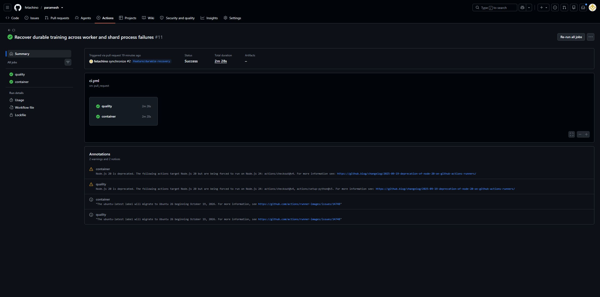
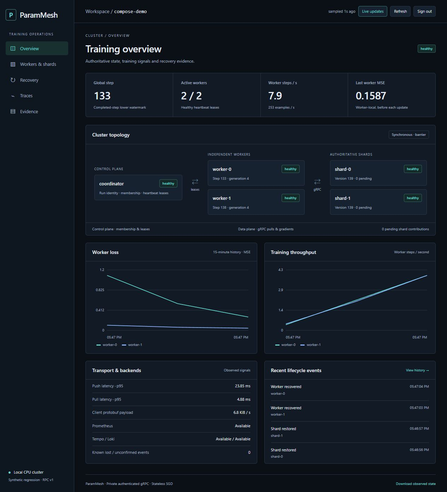
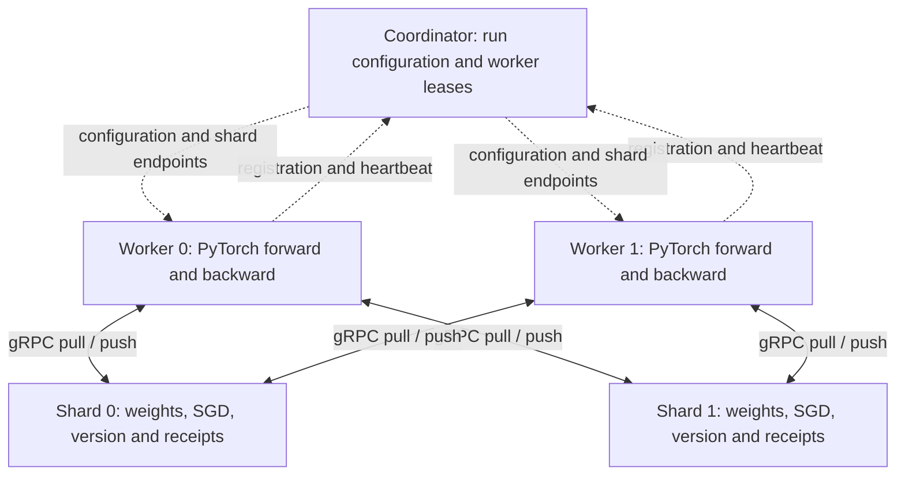
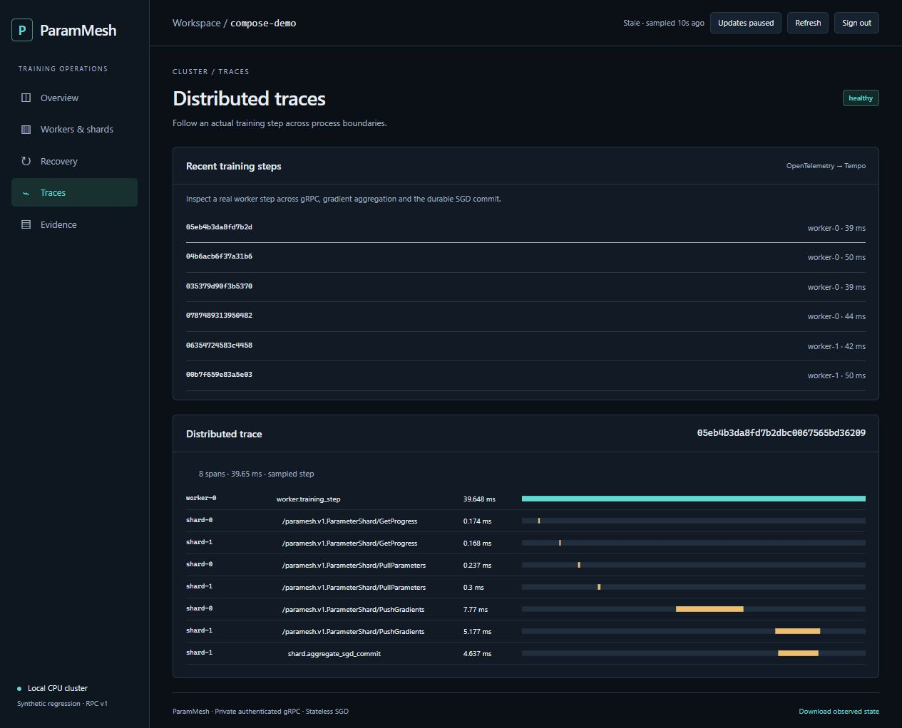

# ParamMesh

ParamMesh is a lightweight, self-hosted distributed training system for teams
that need checkpoint recovery, worker restart and operational visibility without
adopting a large cluster platform. It provides independently running PyTorch
workers, a membership coordinator and sharded authoritative model state. The
repository owns the gRPC protocol, gradient validation, SGD updates, versioning,
replay protection and synchronization behavior.

**Status: local verification, one hosted Coolify deployment, and a two-VM private-network test.** Independent CPU workers and parameter shards
survive tested process failures using durable local state. Synchronous recovery
is checked against equivalent uninterrupted PyTorch SGD. Offline whole-run
checkpoints support local, authenticated S3-compatible and Azure Blob storage, with
actual SeaweedFS and Azurite tests. A read-only operator dashboard uses actual RPC state, Prometheus,
NATS lifecycle history, Tempo traces and Loki logs. A Git-backed Coolify deployment
has run on one Google Cloud x86-64 VM, with an authenticated dashboard over HTTPS
and private Grafana access.
A separate test ran training and observability across two Google Cloud VMs;
the corrected high-rate synchronous checkpoint workload now has repeated
checkpoint, abort/recovery, raw-manifest and numerical evidence. The immutable
GHCR production cutover and compatible-image live rollback/restoration passed;
controlled scaling-performance measurements remain unverified. See the
[single-host evidence](docs/evidence/gcp-single-host-2026-11-03/README.md) and
[completed two-host evidence](docs/evidence/gcp-multihost-919bc0-20261104/README.md), plus the
[hosted HTTPS evidence](docs/evidence/gcp-hosted-https-2026-11-03/README.md),
[live rollback evidence](docs/evidence/gcp-live-rollback-2026-11-04/README.md) and
[local barrier evidence](docs/evidence/checkpoint-barrier-local-20261103/README.md).

[Architecture](ARCHITECTURE.md) · [Evidence and methodology](BENCHMARKS.md) ·
[Security boundaries](SECURITY.md) · [Roadmap](ROADMAP.md)



Actual GitHub Actions results for the recovery milestone; [run details](https://github.com/fetachino/paramesh/actions/runs/41349354085).



Real local Compose training, with scraped loss/throughput and authenticated membership.
Samples across services are collected separately; their step counters need not match.

## What this proves

- Control-plane membership is separate from worker-to-shard gradient traffic.
- Typed network boundaries reject malformed tensors and inconsistent updates.
- Concurrent workers synchronize through explicit shard-local gradient barriers.
- Ambiguous RPC delivery and process restart preserve durable update receipts.
- Write-ahead worker journals finish partially delivered steps without recomputing
  their original synchronous gradients from a partly updated model.
- Synchronous numerical correctness is compared with a real autograd baseline.

## Why this project exists

Parameter servers make optimizer ownership, stale gradients, membership and
failure boundaries explicit. ParamMesh is aimed at small ML infrastructure teams,
research labs and self-hosted environments where recoverable training state and
clear operations matter more than operating a large cluster platform. A small
CPU model keeps the reference workload easy to reproduce, while the protocol and
checkpoint boundaries remain the main subject of the project.

ParamMesh is a good fit when you want a fixed, inspectable topology, durable
whole-run checkpoints, worker recovery and a Docker-based deployment on ordinary
Linux hosts. It is not a replacement for GPU-scale training systems, general
cluster scheduling or high-availability orchestration. Ray, Horovod, DeepSpeed
and similar projects remain better fits for those workloads.

## Run the distributed demo

Requires Python 3.12 on Windows AMD64 or Linux x86-64/ARM64. Native Windows,
local Linux x86-64 containers and an emulated Linux ARM64 Compose stack have
been exercised; native ARM64 hardware remains to be checked.

```powershell
python -m pip install uv==0.13.6
uv sync --locked --all-extras --python 3.12
.\.venv\Scripts\Activate.ps1
paramesh --version
paramesh demo --mode sync --workers 2 --shards 2 --steps 20 --output artifacts/sync.json
```

On Linux, activate with `source .venv/bin/activate`. The demo starts **five child
processes**: one coordinator, two parameter shards and two workers. Actual gRPC
calls carry model parameters and gradients. Parent-owned local IPC carries startup
configuration, ephemeral credentials, stop signals and demo results. Temporary
state and child processes are cleaned up when the command finishes.

The workload is a seeded 4 → 8 → 1 MLP with tanh, 32 synthetic regression examples
per worker and shard-owned SGD. The JSON output records loss, shard versions,
parameter ownership, worker completion, source provenance and the synchronous
reference error. This command is a correctness demonstration, not a scaling benchmark.

[Original core evidence](docs/evidence/README.md) records the baseline numerical
run. Its 20-step sync run reduced full-dataset MSE from 14.232687
to 0.733824 with maximum absolute parameter error `5.96e-8` versus local SGD.

```powershell
paramesh demo --mode async --output artifacts/async.json
paramesh demo --mode bounded --output artifacts/bounded.json
```

### Supplying a PyTorch workload

The worker API also accepts a programmatic `TrainingWorkload` containing a
model factory and a per-worker dataset factory. This keeps model construction
outside the distributed protocol while retaining the bundled MLP as the
reference workload:

```python
import torch

from paramesh.workload import TrainingWorkload
from paramesh.worker import train_worker

workload = TrainingWorkload(
    model_factory=lambda: torch.nn.Linear(4, 1),
    dataset_factory=lambda worker_index: make_batch(worker_index),
)
train_worker("127.0.0.1:50050", "worker-0", 20, workload=workload)
```

The supplied model's named parameters use the same shape, dtype and finite-value
checks as the bundled model. The adapter is currently a Python API; checkpoint
export and restore accept the same workload's deterministic initial parameter
mapping through `parameters_for(workload)`. When the process harness uses the
Windows-safe `spawn` start method, both factories must be importable top-level
functions (avoid lambdas or nested functions). See the runnable
[`examples/external_linear.py`](examples/external_linear.py) example:

```powershell
python examples/external_linear.py
```

The same external workload interface has verified small CPU examples for three model
families:

```powershell
python examples/external_model_families.py linear
python examples/external_model_families.py cnn
python examples/external_model_families.py transformer
```

These are bounded contract examples, not a claim of arbitrary PyTorch compatibility:
they use spawn-safe factories, finite float32 parameters, synchronous CPU SGD, and
the existing two-worker/two-shard process harness. See the [supported contract](docs/supported-contract.md)
for the exact checkpoint and model-state boundaries.

The example exercises two workers, two shards, synchronous SGD, numerical
agreement with a local reference, and the normal dashboard-free process
harness. The checkpoint CLI still uses the bundled reference workload; external
checkpoint export and restore use the deterministic initial mapping returned by
`parameters_for(workload)`. The test suite also covers the external workload in
asynchronous and bounded-staleness modes and after a worker restart.

To show a completed external run in the operator dashboard, set the artifact
directory before starting it:

```powershell
$env:PARAMESH_EXTERNAL_ARTIFACTS_DIR = (Resolve-Path artifacts/external-linear)
python scripts/quickstart.py --no-build
```

The Compose dashboard mounts that directory read-only and labels its rows
**external workload**. This is a read-only post-run manifest view, not live
telemetry from the separate process harness. Leave the variable unset when no
external artifact directory should be mounted.

For a direct scaling comparison against a single-process PyTorch reference, use
the matrix runner. It records raw JSON/CSV, hardware, lock hash, source identity,
and a chart for each requested worker count:

```powershell
python examples/scaling_matrix.py `
  --output artifacts/scaling-matrix `
  --workers 1 2 4 `
  --repetitions 3 `
  --warmup-steps 20 `
  --steps 200
```

This is a controlled workload comparison, not proof of multi-host scaling or a
claim that ParamMesh is faster than PyTorch. Use `--workers 8` only on a host with
enough CPU headroom, and report failed trials rather than dropping them. Clean-source
1/2/4-worker smoke and three-repetition captures with raw files and checksums are
preserved in the [benchmark evidence](docs/evidence/benchmarks/).

For the recovery demonstration, run the actual process-kill harness and keep its
raw report directory:

```powershell
python examples/recovery_demo.py --output artifacts/recovery-demo --repetitions 1
```

This terminates and replaces a worker and a shard in separate trials, then checks
durable progress, equal final shard versions, completed workers, and numerical
agreement with uninterrupted local SGD. To show the captured recovery rows in the
operator dashboard, start the operations profile with the artifact directory:

```powershell
$env:PARAMESH_EXTERNAL_ARTIFACTS_DIR = (Resolve-Path artifacts/recovery-demo)
python scripts/quickstart.py --no-build
```

The dashboard labels these rows **external recovery**. They are local evidence,
not an availability SLA or a claim that arbitrary models recover without compatible
state and protocol configuration.

For a checkpoint-specific recovery walkthrough, use a disposable Compose run and
keep the same persistent volumes throughout the exercise:

```powershell
# Start a normal run, then request a live checkpoint from another terminal.
docker compose --profile maintenance run --rm --no-deps checkpoint checkpoint live-export `
  --id abort-demo --coordinator coordinator:50050 --store /checkpoints

# While the export is waiting at its safe point, interrupt one worker.
docker compose stop worker-1

# Release the uncommitted epoch; this must report {"aborted": true}.
docker compose --profile maintenance run --rm --no-deps checkpoint checkpoint live-abort `
  --id abort-demo --coordinator coordinator:50050

# Rejoin the worker from its durable journal, then publish a new checkpoint ID.
docker compose start worker-1
docker compose --profile maintenance run --rm --no-deps checkpoint checkpoint live-export `
  --id after-abort --coordinator coordinator:50050 --store /checkpoints
```

Verify that `after-abort` has a committed manifest, equal shard versions, and
the expected worker progress. Abort is only valid before publication; retry a
committed ID instead of aborting it. The completed two-host run with raw
manifests, checksums, and direct numerical comparison is preserved in the
[checkpoint gate evidence](docs/evidence/gcp-multihost-919bc0-20261104/README.md).

## Core capabilities

| Area | Working behavior |
| --- | --- |
| Transport | Generated `paramesh.v1` gRPC contracts, deadlines, 8 MiB RPC limit |
| Membership | Configured worker IDs, session leases, suspect/unavailable thresholds, completion |
| Recovery | Durable coordinator metadata, shard commits, worker journals and generation fences |
| Ownership | Stable SHA-256 parameter-name hashing for an immutable shard count |
| Validation | Run, worker, sequence, version, identity, shape, dtype, byte length and finite values |
| SGD | Shard-local authoritative weights; mean or sum aggregation in synchronous mode |
| Synchronous | Fixed membership, one contribution per worker, barrier timeout without a local commit |
| Asynchronous | Atomic local updates with reported shard-local staleness |
| Bounded | Reject excessive shard-local lag; refresh and recompute uncommitted contributions |
| Delivery | Durable latest-step receipts prevent duplicate application after a shard restart |
| Admission | Bounded concurrent RPCs and bounded tensor collections |
| Security | Separate data/admin credentials, private networking and optional TLS/mTLS |

## Architecture and training flow



Workers register, pull parameters, compute a real forward/backward pass, partition
gradients by parameter name, submit each shard's contribution and repeat. Workers
do not own an optimizer. See [ARCHITECTURE.md](ARCHITECTURE.md) for exact semantics.

## Synchronization and failure boundaries

Synchronous mode requires every configured worker at each shard. A missing worker
aborts that shard's pending barrier rather than silently shrinking participation.
Async mode permits older gradients; bounded mode enforces `max_staleness` against
each shard's current version. Mean aggregation assumes equal worker batch sizes.

**There is no cross-shard transaction.** A failure can leave an update committed
on one shard and pending on another. Async and bounded pulls can observe different
shard versions; bounded mode does not provide a globally consistent model snapshot
or classic SSP worker-clock guarantees. Durable journals preserve unfinished
requests after a process crash; rollback after losing local state is a separate,
currently unsupported recovery boundary.

## Reproduce process recovery

```powershell
paramesh demo --failure worker --steps 20 --output artifacts/worker-recovery.json
paramesh demo --failure shard --steps 20 --output artifacts/shard-recovery.json
```

These commands terminate a real process during synchronous training, retain its
state, restart it and require final parameters to match local SGD within `1e-6`.
Worker recovery includes observed heartbeat expiry and a new fencing generation.
Reports record detection and progress-recovery durations, with intentional step
pacing for a visible failure window. Uncommitted computation loss is labeled
unmeasured rather than inferred from a status value.

## Start components independently

Run each command in a separate terminal, with the environment activated. Set
`PARAMESH_RPC_TOKEN` to the same strong URL-safe credential in every component,
and a distinct `PARAMESH_ADMIN_TOKEN` in coordinator/shard terminals only. The
container setup below generates these without printing them. Native component
commands fail closed when credentials are absent.

```powershell
paramesh coordinator --config examples/local.json
paramesh shard --config examples/local.json --index 0
paramesh shard --config examples/local.json --index 1
paramesh worker --coordinator 127.0.0.1:50050 --id worker-0 --steps 20
paramesh worker --coordinator 127.0.0.1:50050 --id worker-1 --steps 20
```

Inspect membership with `paramesh status`. Default state lives under `state/`;
restart against the same state to resume. An already completed worker exits
without repeating training. Use a fresh `--state-dir` for a different run or model;
existing state is never silently reset to fit new configuration.

## Containers

```powershell
python scripts/create_dev_env.py
docker compose up --build -d
docker compose logs -f worker-0 worker-1
docker compose exec coordinator paramesh status --coordinator coordinator:50050
docker compose down
```

Compose defines five separate containers, health checks, non-root execution and
an internal network with no published ports. Workers complete 20 steps and exit.
Five named volumes retain coordinator, shard and worker state. Worker containers
restart on failure and wait for the previous lease to expire before rejoining.
The default private bridge uses authenticated RPCs; no service gets a public
domain or host gRPC port.

`python scripts/verify_compose.py` creates an isolated test project, trains through
the actual container network, checks credential separation and private ports,
recreates all containers and verifies resume without repeated training. It removes
only its own synthetic test volumes. This check passed locally; the CI container
job runs the same script.

`PARAMESH_STEPS` and `PARAMESH_STEP_DELAY` control target steps and optional pacing
for demonstrations. A larger target continues an existing run. The separate
[Coolify deployment](docs/coolify.md) completed 1,000 steps on one Linux VM.

## Inspect the operations stack

For a fresh clone, one command creates ignored credentials, starts the operations
profile, and prints the local operator URLs:

```powershell
python scripts/quickstart.py
```

Use `python scripts/quickstart.py --no-build` after the application image already
exists. If the default UI ports are occupied, pass alternatives such as
`--dashboard-port 18080 --grafana-port 13000`. The wrapper runs
`create_dev_env.py --operations` first; rerunning it preserves existing credentials.

The equivalent individual commands are:

```powershell
python scripts/create_dev_env.py --operations
docker compose --profile operations up --build -d
```

On a fresh clone, `python scripts/create_dev_env.py --operations` creates that
clone's own Git-ignored `.env`, with distinct development credentials and local
operations defaults. No shared passwords or secrets are stored in the repository.
Run the generator before starting the operations profile. Rerunning it preserves
existing values and adds only missing settings.

Open [the operator dashboard](http://127.0.0.1:8080) or
[Grafana](http://127.0.0.1:3000). Both use username `operator`, with separate
generated passwords in this clone's `.env` (`PARAMESH_DASHBOARD_PASSWORD` and
`PARAMESH_GRAFANA_PASSWORD`). Increase `PARAMESH_STEPS` if a retained run already
reached its target.
Only these two UI ports are published, on loopback. Training, messaging, storage
and telemetry ingestion/query ports stay private.

The dashboard shows topology, membership, shard receipts, loss, throughput,
accepted staleness, observed checkpoints, lifecycle events and actual trace spans.
Historical correctness runs are labeled separately from live metrics. NATS carries
lifecycle events only; its outage does not change training correctness.



Actual Tempo spans include the worker step, gRPC calls and a durable shard SGD commit.
See [operator commands and signal definitions](docs/operations.md) for startup,
checkpoint publication, recovery, evidence checks and limits.

`python scripts/verify_operations.py --isolated` starts an owned synthetic stack,
verifies real backend data and private ports, then removes only its test resources.
The CI container job runs both Compose verifiers against the built image.

### Windows download option

If Docker Desktop is installed, users can either download the `paramesh-windows-launcher`
bundle from the manually triggered **Windows launcher bundle** GitHub Actions workflow,
extract it, and choose one of two executables:

- `paramesh-try.exe` runs a disposable two-worker/two-shard synchronous demo directly on
  Windows, opens a local result page, and does not require Docker.
- `paramesh-launcher.exe` starts the full operations stack, but still requires Docker Desktop
  and the bundled Compose files.

The standalone mode is intentionally a local evaluation path: it uses the bundled synthetic
workload and local report storage. Team deployments, persistent checkpoints, observability,
and hosted operation continue to use Docker Compose. Neither executable accesses hosted
production.

The same no-Docker launcher is packaged as `paramesh-local`. After a package is
published through the [trusted PyPI workflow](docs/pypi-publishing.md), install
the train extra with `pipx install "paramesh[train]"` and run `paramesh-local`.
Until that publication is completed, use the locked clean-clone workflow or
download the Windows bundle above.

See the [supported contract](docs/supported-contract.md) for tested boundaries and the
[adoption feedback template](docs/adoption-feedback-template.md) for a sanitized evaluation
report that does not collect credentials or customer data.

Maintainers coordinating an independent trial should use the [evaluator protocol](docs/adoption-evaluation.md)
so setup time, artifact identity, workload shape, and blockers are recorded consistently.

### Example: a small demand-forecasting prototype

Imagine a retail team testing a demand-forecasting model before committing to a larger
training platform. They can split a deterministic training batch by region, run one worker
per region, keep parameters on two shards, and use a checkpoint before changing the worker
pool. If a worker disappears, the team can restart that worker and compare the resumed result
with the uninterrupted reference run. ParamMesh is designed for this kind of inspectable,
small-team experiment: worker leases, shard versions, checkpoint state, and recovery history
are visible instead of hidden behind a cluster scheduler.

The downloadable no-Docker demo uses a bundled synthetic regression workload so it is safe to
try without customer data. It demonstrates the process topology and result workflow; it does
not claim forecast quality or support arbitrary models through the executable yet.

#### Step-by-step: try the local demo

1. Install Windows 10/11 on an AMD64 machine. No Python or Docker installation is required
   for this mode.
2. Sign in to GitHub, open the [Windows launcher workflow](https://github.com/fetachino/paramesh/actions/workflows/windows-launcher.yml),
   select the latest successful run, and open **Artifacts**.
3. Download `paramesh-windows-launcher.zip` and extract it to a folder you control, such as
   `C:\Tools\ParamMesh`.
4. Double-click `paramesh-try.exe`. If Windows SmartScreen appears, verify that you downloaded
   the artifact from the ParamMesh GitHub Actions run and choose **More info → Run anyway**.
5. The program starts two workers and two shards, runs synchronous training, and opens a local
   result page. If it does not open automatically, browse to the printed address, normally
   [http://127.0.0.1:8765](http://127.0.0.1:8765).
6. Review the initial/final loss, shard versions, worker count, and reference error. Use
   **Download report JSON** to keep the result for your own notes. Reports are stored under
   `%USERPROFILE%\.paramesh\runs\` unless you choose another output directory.
7. Close the terminal window or press `Ctrl+C` when finished. The run is disposable; it does
   not modify the hosted deployment or any production credentials.

#### Step-by-step: run the team operations mode

For persistent checkpoints, Grafana, Prometheus, Loki, Tempo, NATS, and the authenticated
operations dashboard:

1. Install Docker Desktop with Linux containers enabled.
2. Extract the same bundle and run `paramesh-launcher.exe`.
3. Open [http://127.0.0.1:8080](http://127.0.0.1:8080) for the dashboard or
   [http://127.0.0.1:3000](http://127.0.0.1:3000) for Grafana.
4. Sign in with username `operator`. The generated passwords are kept in the bundle's local
   ignored `.env`; they are not shared by the repository or the download.
5. Use this mode when the experiment needs durable state, recovery testing, or operational
   evidence. Keep customer data out of the demo until you have reviewed the security and
   storage guidance in [docs/operations.md](docs/operations.md).

## Verification and testing

```powershell
python -m ruff check .
python -m ruff format --check .
python -m mypy
python scripts/generate_proto.py --check
python -m pytest --cov --cov-report=term-missing --cov-report=xml
python -m build
docker compose config --quiet
```

Tests cover real gRPC round trips, concurrent retry delivery, missing barrier
participants, optimizer overflow, lease expiry, old-session rejection and all
three training modes. Spawned-process coverage is enabled. Generated code and the
CLI dispatcher are excluded from coverage; application logic is included.

## Repository structure

```text
proto/paramesh/rpc/       Versioned source protocol
src/paramesh/            Coordinator, shards, workers, workload, CLI and demo harness
src/paramesh/rpc/        Generated Python bindings and message type stubs
tests/                  Unit, network integration and independent-process tests
examples/               Local and container run configurations
tasks/                  Implementation plan
docs/                   Technical designs, operator guides and genuine run evidence
```

## Current limitations and next work

For repeated uncompressed measurements with warm-up, raw JSON/CSV and standalone
charts, see [the benchmark framework and measurement boundaries](BENCHMARKS.md#controlled-uncompressed-framework).
Existing correctness screenshots and startup-inclusive durations remain separate.

The host-addressing, mTLS, NATS TLS, metrics-discovery and restart path is prepared
and verified on an isolated private Docker network; that remains a single-host
simulation. Compression and controlled multi-host performance measurements remain pending. Process restart requires retained local volumes;
offline whole-run recovery can use an exported local/S3/Azure checkpoint. The system
does not provide coordinator consensus or replicated live training state.
The protocol is float32-only and the workload is fixed and CPU-only.

See [checkpoint operator commands](docs/checkpoints.md) for private SeaweedFS/Azurite verification,
offline export, coordinated live export, fresh-directory restore and fresh-volume installation.
Live export quiesces active workers and fences all shards; offline export requires
stopping the full run. Both retain the original topology. Larger-payload/network
benchmarks and remaining release work follow in [ROADMAP.md](ROADMAP.md).

## Additional documentation

- [Implementation plan](tasks/plan.md)
- [Operations and signals](docs/operations.md)
- [Dependency locking and updates](docs/dependencies.md)
- [Git-backed Coolify deployment](docs/coolify.md)
- [Immutable deployment and rollback](docs/immutable-deployment.md)
- [Multi-host Linux deployment path](docs/multi-host.md)
- [Architecture and consistency model](ARCHITECTURE.md)
- [Correctness evidence and benchmark policy](BENCHMARKS.md)
- [Python package publication](docs/pypi-publishing.md)
- [Release-readiness audit and deployment limits](docs/release-readiness.md)
- [v1.0.0 release candidate notes](docs/releases/v1.0.0.md)
- [Changelog](CHANGELOG.md)
- [Security model](SECURITY.md)
