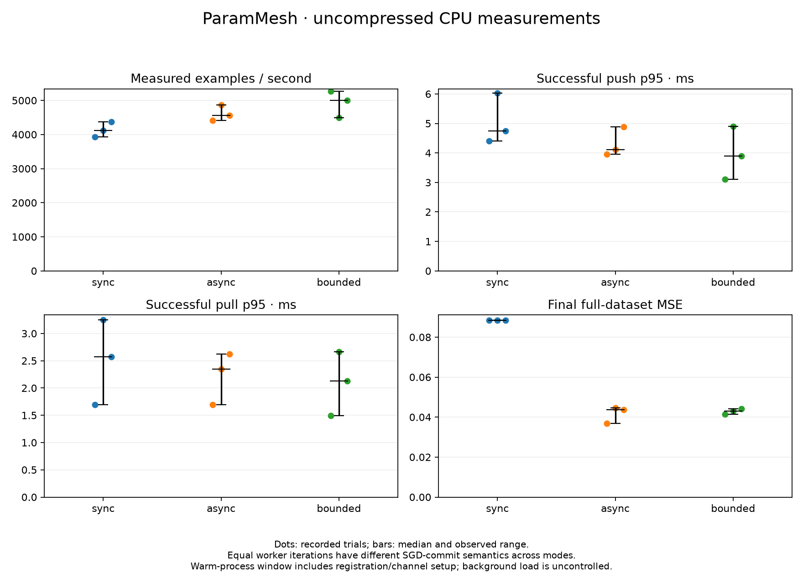

# Local uncompressed baseline

Nine actual trials captured from clean source
`7d9a946a3e51f40b06d21d1aad06350ac9f35c3c`, November 2, 2026 UTC.
Every trial records that revision with `source_dirty=false`. Raw files were copied
without modification; `SHA256SUMS` covers the capture artifacts and exact lock snapshot.
Local Git attributes prevent line-ending conversion of these captured files.

Host: Windows 11 AMD64, Intel Core i7-13700F, 24 logical CPUs, 34,055,766,016 bytes
OS-reported physical memory. Python 3.12.10/PyTorch 2.15.0+cpu; exact package lock hash
is in `manifest.json`. The retained Docker operations stack remained running.
No tests/builds ran concurrently, but other workstation load was not controlled.

Configuration: two workers/two shards; 20 warm-up and 200 measured steps per worker;
three repetitions of sync/async/bounded, with mode order rotated. Each trial processes
12,800 measured examples, reusing the seeded 32-example batch per worker. Transport
is float32 without compression; SQLite durability remains enabled. Bounded lag is 1.

| Mode | Median examples/s (observed range) | Median successful push p95, ms | Median successful pull p95, ms | Measured commits per shard | Median final MSE |
| --- | --- | --- | --- | --- | --- |
| Sync | 4,119 (3,933–4,368) | 4.743 | 2.576 | 200 | 0.08849 |
| Async | 4,562 (4,415–4,873) | 4.108 | 2.350 | 400 | 0.04379 |
| Bounded | 4,999 (4,488–5,273) | 3.894 | 2.133 | 400 | 0.04308 |

These are warm-process session measurements, including channel setup,
registration/fencing and final heartbeat. They are not isolated steady-state rates
or equal-quality speedups. Different SGD update budgets and only three repetitions
preclude a general training-quality/performance ranking or significance claim.

All three synchronous runs matched the local SGD reference with maximum absolute
parameter error `4.77e-7`, below the existing `1e-6` gate. All 21,730 client attempts
returned OK; raw capture reported no drops. There were 7,200 gradient pushes.
No failure or overload recovery property follows from this healthy-run dataset.

The complete model gradient contains 49 float32 values, 196 raw tensor bytes per
worker iteration. Mean per-shard push requests were about 192 protobuf bytes,
including metadata. This tiny-model, local-loopback experiment provides no evidence
of a bandwidth bottleneck. Compression is therefore deferred rather than justified
by the observed mode rates; larger-payload and controlled-network experiments are
needed before selecting a codec or accepting accuracy/CPU tradeoffs.

`trial-*.json` preserve complete trial/configuration/loss/RPC records; `rpc.csv` and
`trials.csv` preserve raw attempts and per-trial summaries. The chart is generated
from those summaries, with observed ranges rather than confidence intervals.
See [the framework methodology](../../../../BENCHMARKS.md) for precise boundaries.
